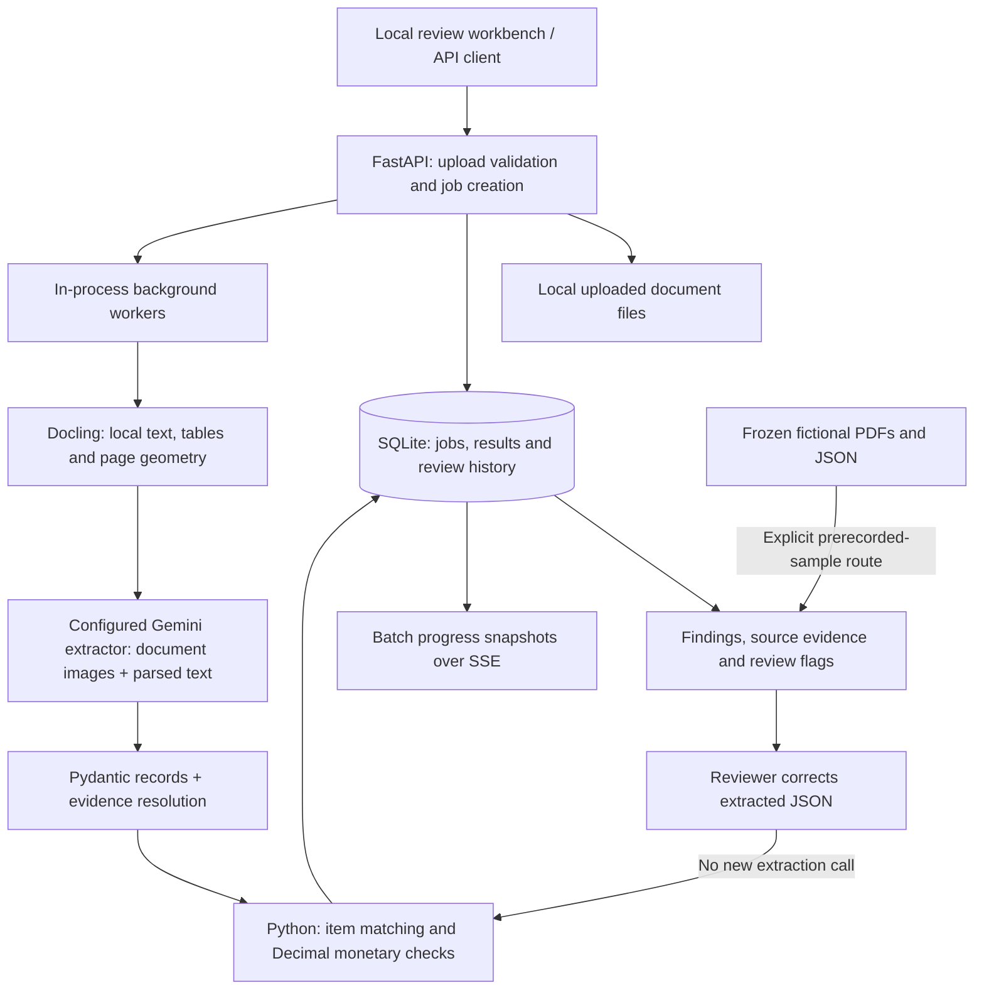

# ReconcileAI architecture guide

ReconcileAI is a local portfolio workflow for evidence-linked invoice/purchase-order review. Models extract records; deterministic code compares them; humans can correct and rerun the checks. It does not authorize payment or write to an ERP. See the [three-minute demo and spoken explanation](demo-script.md) and [evidence map](evidence.md).

## Runtime boundaries

Docling parses each document before its model extraction. For an invoice/PO pair, the two parses are scheduled together, followed by the two extraction calls; provider throttling still applies. This is a staged workflow, not a claim that every operation or document executes serially. The separate Gradio sample viewer does not execute this upload/correction pipeline.

## One request, end to end

1. **Validate and persist inputs:** [the API](../src/main.py) checks suffix, initial magic bytes and size, saves local files, and records a job. These checks are early rejection, not a full document malware scan.
2. **Parse before extraction:** Docling supplies actual document text and layout. The configured Gemini extractor receives that parsed context plus document images; labels from the evaluation set do not enter extraction prompts.
3. **Validate and resolve evidence:** typed records are validated and source evidence is resolved locally. Unsupported or low-confidence evidence creates review flags; a plausible model response alone is not verified support.
4. **Run deterministic controls:** [the reconciliation engine](../src/reconciliation/engine.py) matches items and checks monetary discrepancies using `Decimal` with cent rounding. The model can emit incorrect numbers, but it does not decide the final match/discrepancy rules.
5. **Store and review:** persist results, display supported source regions and let a human correct records. `PUT /api/v1/jobs/{job_id}/review` validates edited extractions, reruns the engine and appends before/after records without another model call. This avoids new inference charges, not all compute/storage cost; it is not a tamper-proof audit system.
6. **Report failures:** parsing, provider, schema and document-limit failures are stored as failed jobs rather than silently replaced by sample results.

## State and restart behavior

| State | Default location / owner | Operational boundary |
| --- | --- | --- |
| Uploaded documents | `data/uploads/`, configured through `DATA_DIR` | Sensitive local files; retained separately from database rows |
| Jobs, results, corrections and usage | SQLite, `data/reconcile_ai.db` by default | Paths are configurable in [settings](../config.py); preserve files and database together |
| Active work | In-process background tasks | Not a durable distributed queue or globally claimed work list |
| Incomplete jobs on startup | Reloaded from [JobStore](../src/storage.py) and rescheduled | Reprocessing after interruption is not an exactly-once provider-call guarantee |
| Public evaluation response caches | Separate ignored evaluation files | Not a fallback or cache for private application uploads |

Batch uploads are independent extraction jobs, not automatic invoice/PO pairing. `BATCH_WORKERS` bounds workers for each submitted job group; it is not a global concurrency cap across simultaneous batches. SSE reports persisted progress snapshots rather than provider-token streaming. Run one Uvicorn process: multiple processes can duplicate startup recovery; distributed operation needs durable queueing and job claiming.

## Why a workflow instead of an agent

Invoice reconciliation has known stages and objective checks. A fixed workflow makes failures observable and keeps the model away from the final financial decision. Gemini performs schema-guided perception; deterministic code owns item matching, decimal arithmetic, discrepancies, and review history.

## Trust boundaries

- Uploaded files are untrusted. Their printed instructions are explicitly treated as content, not authorization; this is not a general prompt-injection immunity claim.
- The API key stays in the backend environment and is never returned to the browser. The live extraction path sends document images and parsed text to the configured provider; use fictional demo files, not private financial records.
- The prototype API has no user-authentication layer. Do not expose it to untrusted clients. The convenience start script binds `0.0.0.0`; for a local-only walkthrough, use the loopback command in the [demo script](demo-script.md). Typed validation, source evidence and SQLite persistence are not secure multi-user deployment controls.
- Model output is parsed through Pydantic before reconciliation.
- High-value fields and rows require locally resolved source evidence. Missing support or evidence below `CONFIDENCE_THRESHOLD` creates a review flag. This score is a text-match heuristic, not a calibrated probability. The recorded held-out receipt comparison reports reliability errors and review routing; it does not demonstrate reduced human-review workload.
- SQLite preserves job status, results, errors, provider usage, and reviewer changes across restarts.
- The application development spend guard checks accumulated estimated Gemini cost before a job. It is not a hard per-call reservation or billing cap. The evaluation runner's persistent reservation ledger is a separate mechanism.

## Failure behavior

Provider errors, invalid structured output, document limits, and parser errors move the job to `failed` with a visible message. There is no silent fallback to sample data. On restart, queued/processing jobs resume through bounded in-process workers. Completed jobs are retained. Batch uploads are validated before workers start, failed uploads are cleaned up, and SSE exposes persisted progress snapshots. One Uvicorn process is supported; distributed execution needs a durable queue with job claiming.

## Evaluation and public demo

CORD images and label manifests are pinned separately. Gemini vision, Groq Qwen and Docling-text-only Gemini share the typed extraction schema and evidence resolver. Expected labels never enter extraction prompts; they are supplied only to the diagnostic judge after scoring. Public benchmark raw responses are cached for offline rescoring; production uploads do not use this cache. Cost reservations persist before requests to preserve the evaluation budget on timeouts or interruption.

The Gradio demo is a separate sample-only entrypoint prepared for Spaces with no extraction code or credentials. An explicit deployment allowlist contains only fixed fictional PDFs, precomputed JSON, the UI and its minimal dependencies. There is no hosted demo; this deployment capability is not evidence of an operating service. The API workbench, unlike the read-only Gradio sample, supports corrections and rerunning controls.

The [evidence map](evidence.md) separates seven-field CORD receipt extraction, 50-pair deterministic fixture checks and the optional live invoice/PO experiment. Receipt field scoring compares value multisets, not row associations. Neither fixture success nor receipt F1 is an end-to-end reconciliation accuracy claim. Reported cost is configured token-cost estimation, not billed spend or business savings.

## Main trade-off and limits

Combining local geometry with model extraction makes results inspectable and correctable, but parsing and perception errors can compound. A deterministic control can faithfully evaluate the wrong extracted number. Local files, SQLite and in-process tasks keep the prototype reproducible; they do not provide distributed execution, tenant isolation or payment authorization.

The measured receipt scorer does not establish correct line-item associations, and the synthetic fixture checks do not establish end-to-end model reconciliation accuracy. The local prerecorded sample demonstrates review behavior, not fresh extraction. No hosted service or new evaluation is introduced by this guide.

## Matching policy

Rows match by case-insensitive SKU when available. Otherwise, normalized description similarity must be at least `0.55`; close competing candidates create an ambiguous-match review item. Money uses `Decimal` rounded to cents. Currency mismatches stop meaningful price comparison and remain critical findings.

Extraction and diagnostic judging use gemini-3.1-flash-lite through the OpenAI-compatible HTTP transport. A process-wide throttle and bounded exponential retries apply to HTTP 429 and transient 503; transport timeouts propagate. The diagnostic judge sees labels after scoring and cannot change field F1. Same-model preference and shared reasoning errors limit its diagnoses; selected failures are also visually reviewed. Groq retries respect Retry-After, and its VLM adapter sends all pages of PDFs up to three pages, rejecting longer documents before inference.
